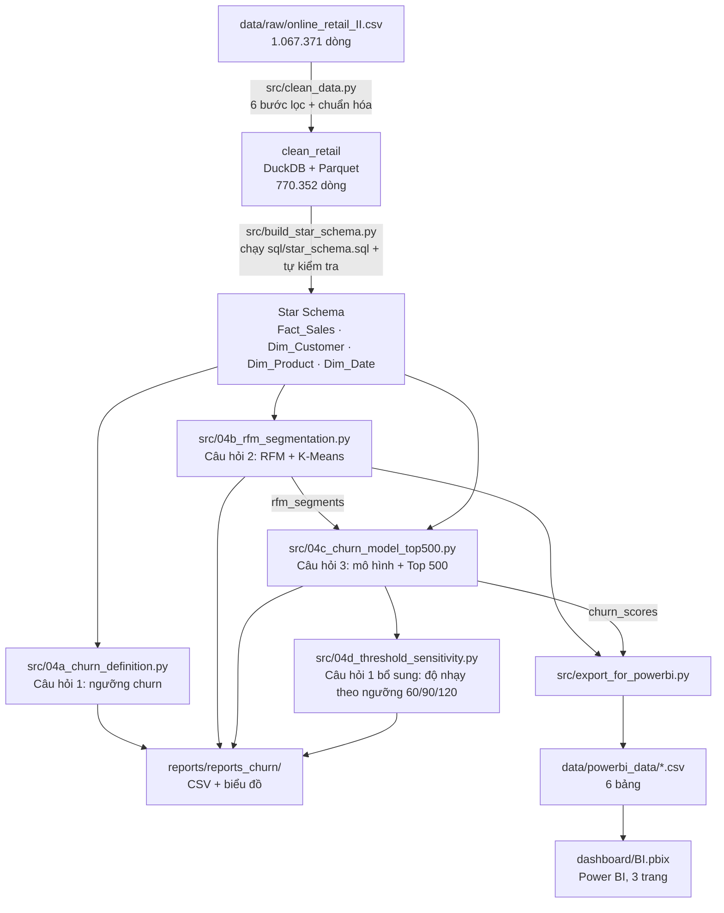

# Customer Churn Analysis — Online Retail II

Đề tài phân tích hành vi khách hàng và dự báo churn (rời bỏ) trên bộ dữ liệu bán lẻ trực tuyến **Online Retail II** (UCI Machine Learning Repository). Các bước gồm: làm sạch dữ liệu, dựng kho dữ liệu dạng Star Schema, trả lời 3 câu hỏi kỹ thuật (định nghĩa churn, phân khúc RFM, dự báo churn bằng Machine Learning), dựng dashboard Power BI và lập danh sách 500 khách hàng cần ưu tiên chăm sóc.

Báo cáo thực tập: [`reports/Bao_cao_thuc_tap.docx`](reports/Bao_cao_thuc_tap.docx)

---

## 1. Giới thiệu đề tài

Bộ dữ liệu gốc ghi lại **1.067.371 dòng giao dịch** bán lẻ trực tuyến của một doanh nghiệp tại Anh, từ 01/12/2009 đến 09/12/2011. Mỗi dòng có 8 trường: `Invoice, StockCode, Description, Quantity, InvoiceDate, Price, Customer ID, Country`. Doanh nghiệp hoạt động theo mô hình **non-contractual**, tức là khách hàng không ký hợp đồng ràng buộc. Vì vậy không có thời điểm nào khách "báo" là mình rời bỏ: churn phải được suy ra từ khoảng thời gian khách không mua hàng.

**Mục tiêu:**
- *Kỹ thuật*: xây dựng pipeline xử lý dữ liệu tái lập được (reproducible) bằng một lệnh, kho dữ liệu dạng Star Schema trong DuckDB, và mô hình dự báo churn được kiểm định theo thời gian (huấn luyện trên 2010, kiểm thử trên 2011).
- *Nghiệp vụ*: tìm những khách hàng vừa có nguy cơ rời bỏ cao vừa mang lại doanh thu lớn, từ đó đề xuất danh sách 500 khách hàng ưu tiên chăm sóc để dùng ngân sách hiệu quả nhất.

**Công nghệ sử dụng**: Python 3.11 (pandas, scikit-learn, matplotlib, seaborn, duckdb), Power BI Desktop, Git/GitHub. DBeaver là tùy chọn, chỉ dùng để xem dữ liệu.

---

## 2. Kiến trúc hệ thống



Toàn bộ chuỗi trên chạy bằng **một lệnh**: `python src/run_pipeline.py` (xem mục 3.4).

Star Schema có grain là **1 dòng hàng trong 1 hóa đơn** (line item). `Fact_Sales` nối tới `Dim_Customer` qua `CustomerID`, tới `Dim_Product` qua `StockCode`, và tới `Dim_Date` qua `DateKey` (dạng `YYYYMMDD`). Cuối `sql/star_schema.sql` có 3 câu kiểm tra "mồ côi", bảo đảm mọi dòng Fact đều tìm được dòng tương ứng ở các bảng Dim.

### Cấu trúc thư mục

```
customer-churn-online-retail/
├── data/
│   ├── raw/                        # dữ liệu gốc (KHÔNG commit, xem mục 3.3)
│   ├── processed/                  # retail.duckdb, .parquet, rfm_segments.csv, churn_scores.csv (KHÔNG commit, tự tạo)
│   └── powerbi_data/               # 6 file CSV cho Power BI (CÓ commit, để mở dashboard ngay không cần chạy lại)
├── sql/
│   ├── star_schema.sql             # tạo Star Schema + kiểm tra mồ côi
│   ├── quality_checks.sql          # kiểm tra chất lượng dữ liệu sạch
│   └── aggregation_queries.sql     # các truy vấn tổng hợp mẫu
├── src/
│   ├── run_pipeline.py             # chạy toàn bộ pipeline theo đúng thứ tự
│   ├── common.py                   # cấu hình dùng chung: đường dẫn, kết nối DuckDB, ngưỡng churn, snapshot đặc trưng
│   ├── clean_data.py               # làm sạch dữ liệu
│   ├── build_star_schema.py        # dựng Star Schema + tự kiểm tra
│   ├── 04a_churn_definition.py     # câu hỏi 1: định nghĩa churn
│   ├── 04b_rfm_segmentation.py     # câu hỏi 2: RFM + K-Means
│   ├── 04c_churn_model_top500.py   # câu hỏi 3 + danh sách Top 500
│   ├── 04d_threshold_sensitivity.py  # độ nhạy của mô hình và Top 500 theo ngưỡng churn
│   ├── export_for_powerbi.py       # xuất CSV cho Power BI
│   ├── inspect_raw.py              # xem nhanh dữ liệu gốc
│   └── check_env.py                # kiểm tra môi trường đã cài đủ thư viện
├── dashboard/
│   └── BI.pbix                     # dashboard Power BI (3 trang)
├── reports/
│   ├── reports_churn/              # CSV kết quả + figures/ (biểu đồ PNG)
│   ├── cleaning_log.csv            # nhật ký số dòng bị loại ở mỗi bước làm sạch
│   ├── Top500_KhachHang_ChamSoc.xlsx  # danh sách Top 500 cho bộ phận kinh doanh
│   └── Bao_cao_thuc_tap.docx       # báo cáo thực tập
├── requirements.txt
├── .gitignore
└── README.md
```

---

## 3. Hướng dẫn cài đặt và chạy lại

### 3.1. Yêu cầu

- Python **3.11** trở lên (pandas 3.0 trong `requirements.txt` không chạy được trên 3.10 trở xuống)
- [Power BI Desktop](https://www.microsoft.com/power-bi/desktop) (chỉ có trên Windows), dùng để mở `dashboard/BI.pbix`
- [DBeaver Community](https://dbeaver.io), *tùy chọn*, chỉ để xem dữ liệu bằng SQL

### 3.2. Cài môi trường

```powershell
git clone https://github.com/TruongTI/customer-churn-online-retail.git
cd customer-churn-online-retail

py -3.11 -m venv .venv
.venv\Scripts\Activate.ps1                  # macOS/Linux: source .venv/bin/activate

python -m pip install --upgrade pip
pip install -r requirements.txt
python src\check_env.py                     # in ra phiên bản các thư viện
```

### 3.3. Tải dữ liệu

File dữ liệu gốc không được commit lên repo vì nặng khoảng 95 MB, gần giới hạn file 100 MB của GitHub. Tải **Online Retail II** từ [Kaggle](https://www.kaggle.com/datasets/mashlyn/online-retail-ii-uci) và đặt file CSV vào đúng đường dẫn:

```
data/raw/online_retail_II.csv
```

Nếu bạn tải bản `.xlsx` gồm 2 sheet từ UCI, hãy gộp 2 sheet thành 1 file CSV có cùng 8 cột: dùng `pandas.read_excel(..., sheet_name=None)` rồi `pd.concat`.

### 3.4. Chạy lại toàn bộ pipeline

> **Trước khi chạy:** nếu DBeaver đang kết nối tới `data/processed/retail.duckdb`, hãy chuột phải vào kết nối rồi chọn **Disconnect** (hoặc đóng DBeaver). DuckDB chỉ cho một chương trình mở file khi có kết nối ghi. Nếu quên, script sẽ dừng và báo rõ lý do.

```powershell
python src\run_pipeline.py
```

Lệnh này chạy lần lượt `clean_data` → `build_star_schema` → `04a` → `04b` → `04c` → `04d` → `export_for_powerbi` và dừng ngay ở bước nào bị lỗi. Trên laptop thông thường mất khoảng 1–2 phút. Các script tự tính đường dẫn từ thư mục gốc repo, nên đứng ở thư mục nào chạy cũng được.

Chạy tiếp từ một bước, ví dụ sau khi sửa lỗi ở bước 04c:

```powershell
python src\run_pipeline.py --from 04c_churn_model_top500
```

Chạy riêng từng bước (đúng thứ tự):

```powershell
python src\clean_data.py
python src\build_star_schema.py
python src\04a_churn_definition.py
python src\04b_rfm_segmentation.py         # 04c dùng kết quả của bước này
python src\04c_churn_model_top500.py
python src\04d_threshold_sensitivity.py
python src\export_for_powerbi.py
```

Pipeline có sẵn các kiểm tra để chặn việc vô tình dùng dữ liệu cũ:
- 04a/04b/04c và bước export **từ chối chạy** nếu `Fact_Sales` không khớp `clean_retail`, ví dụ khi đã chạy lại `clean_data.py` mà quên chạy `build_star_schema.py`.
- 04c từ chối chạy nếu `rfm_segments.csv` chưa có hoặc là kết quả của lần chạy trước.

Sau khi pipeline chạy xong, mở `dashboard\BI.pbix` trong Power BI Desktop và chọn **Home → Refresh** để nạp dữ liệu mới từ `data/powerbi_data/`.

Ngưỡng churn (90 ngày), cửa sổ "đang hoạt động" (180 ngày) và cửa sổ đặc trưng (270 ngày) chỉ được khai báo một lần, ở đầu `src/common.py`.

### 3.5. Kiểm tra chạy lại thành công

Khi chạy trên đúng file dữ liệu gốc, kết quả phải có các dòng sau:

```
6. Bỏ dòng bán đã bị hủy đúng số lượng        loại    6,227  còn   770,352
Các kiểm tra chất lượng: ĐẠT
Số khách hàng: 5,839 | Số hóa đơn: 36,324 | Số sản phẩm: 4,612 | Tổng doanh thu: 16,460,265
Kiểm tra vi phạm, mồ côi, khớp clean_retail: ĐẠT
Pipeline chạy xong.
```

Nếu muốn kiểm tra thêm trong DBeaver: chạy câu số 2 trong `sql/quality_checks.sql`, tất cả các cột phải bằng **0**.

---

## 4. Tóm tắt kết quả chính

| Hạng mục | Kết quả |
|---|---|
| Dữ liệu sạch | 770.352 / 1.067.371 dòng (72,2%), gồm 5.839 khách hàng, 36.324 hóa đơn, 4.612 sản phẩm; doanh thu khoảng 16,46 triệu GBP |
| Ngưỡng churn | **90 ngày** không mua hàng. Mốc này xấp xỉ phân vị 80% của khoảng cách giữa 2 lần mua (88 ngày); tỷ lệ churn trung bình 50,5% (dao động 38–62%) qua các snapshot cuối tháng . Khi chạy lại với 60 và 120 ngày, các kết luận chính không đổi: không có model drift, Revenue at Risk vẫn là chiến lược tốt nhất (43–46%), Top 500 trùng 78–85% khách |
| Phân khúc RFM | Champions chiếm 26,1% số khách nhưng tạo **71,6% doanh thu**. Tỷ lệ khách giữ nguyên phân khúc giữa 2 quý liên tiếp trung bình 54,2% (41–63%). Phân cụm K-Means (k=4) khớp vừa phải với phân khúc theo quy tắc (ARI 0,525) |
| Mô hình churn | ROC-AUC trên 2011: Logistic Regression **0,751**, Random Forest **0,739**. Cả hai đều cao hơn trên tập giữ lại năm 2010 (0,695), tức là không thấy hiệu năng suy giảm. PSI của cả 12 đặc trưng ≤ 0,026: phân phối đầu vào ổn định |
| Top 500 (kiểm chứng ngược tại 10/09/2011) | Chọn theo **Revenue at Risk** (xác suất churn × doanh thu ước tính 90 ngày) bắt được **43,2%** doanh thu ước tính bị mất. Các cách khác: theo giá trị 30,3%, ngẫu nhiên 17,9%, theo xác suất churn 12,0% |
| Danh sách hành động (09/12/2011) | 3.464 khách đang hoạt động được chấm điểm. Top 500 chiếm 38,8% tổng Revenue at Risk, gồm 254 Champions, 136 Loyal, 88 Potential Loyalist, 22 Need Attention |
| Dashboard | Power BI 3 trang: Executive Overview (doanh thu theo tháng, cohort retention), Customer Segmentation, Actionable Churn List (Top 500 kèm Revenue at Risk; xuất dữ liệu qua **More options (...) → Export data**) |

*"Doanh thu ước tính bị mất"* được tính bằng doanh thu trung bình trong 90 ngày (ước từ lịch sử mua trước snapshot) của những khách thực sự không quay lại trong 90 ngày sau đó. Đây là con số ước tính, không phải doanh thu thực tế bị mất.

Chi tiết phương pháp, số liệu và khuyến nghị: xem `reports/Bao_cao_thuc_tap.docx`. Kết quả dạng CSV và biểu đồ: `reports/reports_churn/`.

---

## 5. Hạn chế đã biết

- **Tập trung một thị trường:** 83,5% doanh thu đến từ khách hàng tại United Kingdom.
- **Tháng 12/2011 chỉ có dữ liệu đến ngày 09.** Bảng `Monthly_Overview` có cột `IsPartialMonth` để lọc tháng này ra khi phân tích xu hướng theo tháng.
- **Chưa trừ được đơn hủy một phần.** Chỉ những dòng hủy khớp đúng (khách, mã hàng, số lượng) với một dòng bán trước đó mới được trừ. Khoảng 10.300 dòng hủy khác số lượng, trị giá khoảng 135 nghìn GBP (≈ 0,8% doanh thu), chưa được trừ.
- **Ngưỡng 90 ngày khá ngắn:** 63,8% số lần khách im lặng quá 90 ngày sau đó vẫn quay lại mua. Ngưỡng 90 ngày được chọn vì cần hành động sớm và cần tập nhãn cân bằng cho mô hình, nên một phần khách bị gán "churn" thực ra chỉ tạm ngừng mua.
- **Giả định trong đặc trưng:** khách chỉ mua trong 1 ngày được gán `avg_gap` = 270 ngày. Với khách có thâm niên dưới 90 ngày, doanh thu 90 ngày được ước tính bằng toàn bộ số tiền đã mua.
- **Tập kiểm định 2010 nhỏ** (848 khách), nên chênh lệch AUC giữa 2010 và 2011 có độ bất định đáng kể.
- **Xuất Excel từ dashboard:** Power BI Desktop chỉ xuất dữ liệu của visual ra file `.csv` (mở được bằng Excel). Muốn xuất thẳng `.xlsx` cần publish báo cáo lên Power BI Service.
- **Các tham số ROI** trong `04c_churn_model_top500.py` (chi phí 10 GBP/khách, tỷ lệ giữ chân 15%, biên lợi nhuận 30%) là **giả định minh họa**, cần thay bằng số liệu thực tế của doanh nghiệp.
